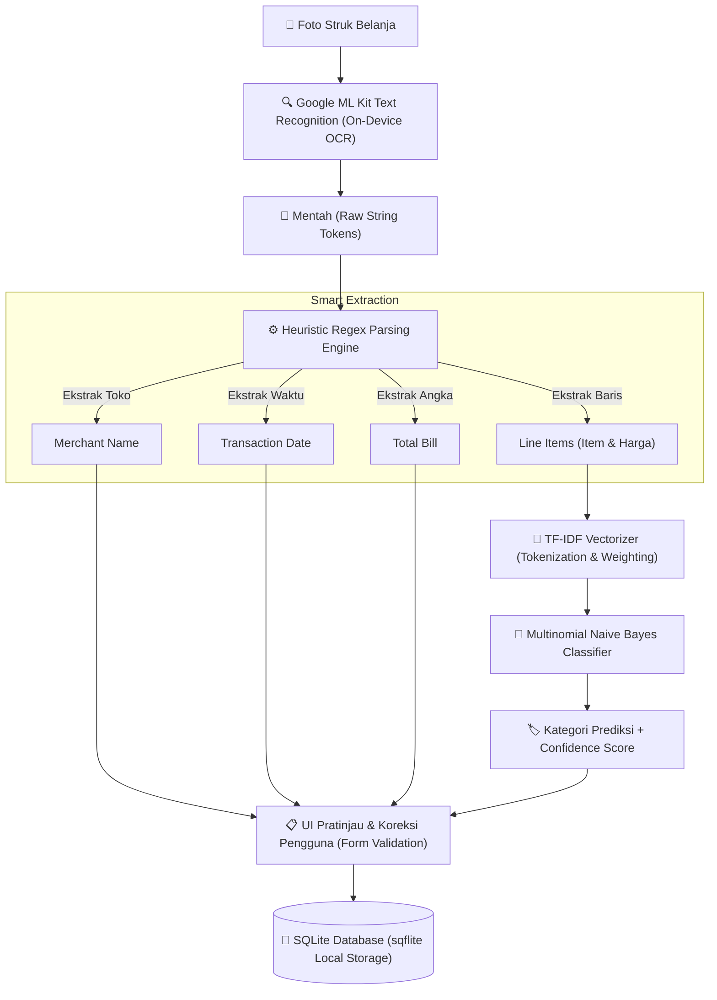
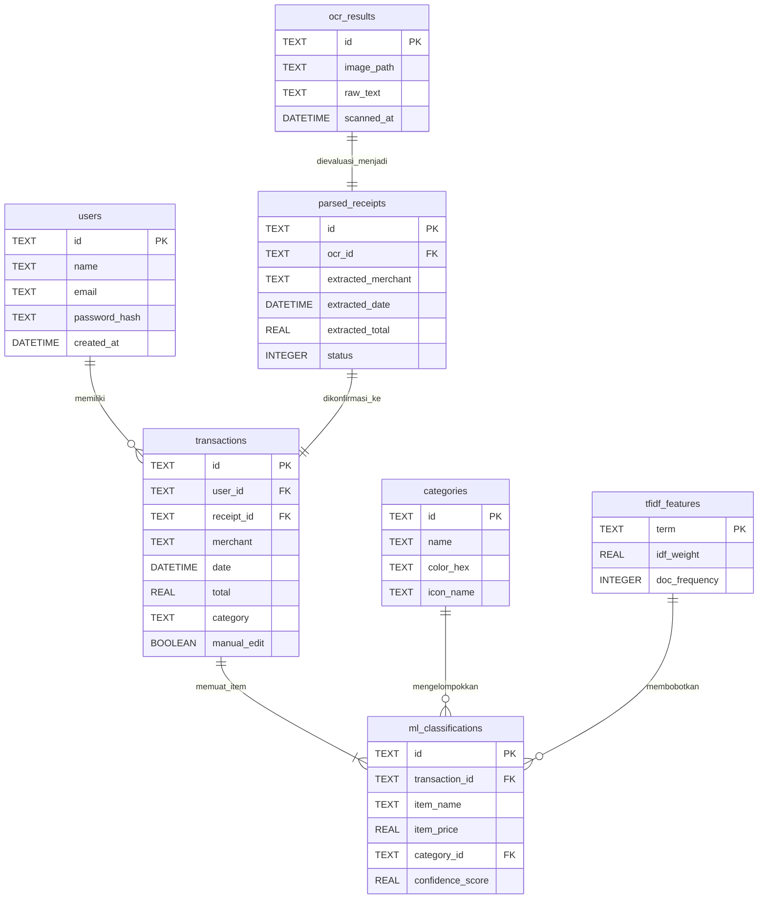

<div align="center">

# 🧾 SmartReceipt
### *Intelligent On-Device Expense Tracker with OCR & Machine Learning*

Aplikasi pencatatan keuangan pribadi berbasis **Flutter** yang mengotomatisasi konversi fisik struk belanja menjadi data pengeluaran terstruktur secara **100% offline (on-device)** menggunakan Optical Character Recognition (OCR) dan algoritma Machine Learning NLP.

[](https://flutter.dev)
[](https://dart.dev)
[](https://flutter.dev)
[-003B57?style=for-the-badge&logo=sqlite&logoColor=white)](https://pub.dev/packages/sqflite)
[](https://github.com)
[](LICENSE)

[Fitur Utama](#-fitur-utama) •
[Arsitektur Sistem](#-arsitektur-sistem--alur-data) •
[Struktur Basis Data](#-skema-basis-data-sqlite) •
[Struktur Proyek](#-struktur-direktori-proyek-mvvm) •
[Instalasi](#-panduan-instalasi--menjalankan-proyek)

---

</div>

## 📌 Ringkasan & Unique Selling Points (USP)

Pencatatan keuangan harian sering kali terbengkalai karena repotnya memasukkan rincian struk belanja secara manual. **SmartReceipt** hadir menjawab tantangan ini dengan pendekatan **Privacy-First & Offline-First**.

### 🌟 Nilai Unggul (USP)
- 🔒 **Zero Server Dependency (100% Privacy-First):** Seluruh proses ekstraksi teks OCR, inferensi machine learning, hingga penyimpanan database berjalan langsung di dalam perangkat (*edge computing*). Data finansial pengguna tidak pernah meninggalkan ponsel.
- ⚡ **Otomatisasi Cerdas Berkecepatan Tinggi:** Dari foto struk belanja menjadi transaksi siap simpan hanya dalam hitungan detik berkat kombinasi *on-device OCR*, *heuristic regex parser*, dan klasifikasi Naive Bayes teroptimasi.
- 🎯 **Presisi Kategori Berbasis Probabilitas:** Klasifikasi kategori tidak sekadar mencocokkan kata kunci kaku, melainkan menggunakan pembobotan **TF-IDF (Term Frequency-Inverse Document Frequency)** dan probabilitas posterior **Multinomial Naive Bayes**.

---

## ✨ Fitur Utama

| Fitur | Deskripsi | Teknologi |
| :--- | :--- | :--- |
| **Scanning & OCR** | Deteksi teks cepat & akurat langsung dari kamera atau galeri foto struk belanja. | Google ML Kit Text Recognition |
| **Smart Regex Parsing** | Ekstraksi otomatis metadata kunci: Nama Merchant, Tanggal Transaksi, Total Tagihan, dan Item Barang. | Deterministic Heuristic Regex |
| **AI Auto-Categorization** | Pengelompokan barang belanjaan otomatis (Konsumsi, Transportasi, Kesehatan, Belanja, dll.) dengan confidence score. | TF-IDF + Multinomial Naive Bayes |
| **Pratinjau & Interaktif Edit** | Validasi visual interaktif untuk mengoreksi nominal, mengganti kategori, atau menambah item secara manual sebelum disimpan. | Dynamic Form & Change Detection |
| **Manajemen Riwayat & Pencarian** | Filter kategori real-time, pencarian instan nama merchant/item, dan mutasi saldo pengeluaran bulanan. | SQLite Indexed Querying |
| **UI/UX Modern Material Design 3** | Tampilan bersih, ergonomis, berbasis kartu (*card-based*), dihiasi palet warna *Emerald Green* (`#10B981`) dan *Off-White* (`#F8FAFC`). | Flutter Material 3 |

---

## 📱 Demo Visual Antarmuka

```text
┌───────────────────────┐   ┌───────────────────────┐   ┌───────────────────────┐
│     [ BERANDA ]       │   │    [ SCAN & OCR ]     │   │   [ VALIDASI DATA ]   │
│                       │   │                       │   │                       │
│  Rp 1.450.000         │   │   [ Kamera ] [Galeri] │   │ Merchant: Indomaret   │
│  Pengeluaran Oktober  │   │                       │   │ Tanggal : 14/10/2026  │
│                       │   │  Teks Terbaca:        │   │ Total   : Rp 27.500   │
│  ■ Konsumsi    65%    │   │  "INDOMARET           │   │                       │
│  ■ Transport   20%    │   │   Roti Tawar 15.000   │   │ [x] Roti Tawar        │
│  ■ Kesehatan   15%    │   │   TOTAL 15.000"       │   │     Konsumsi (98.4%)  │
│                       │   │                       │   │                       │
│  [ Riwayat Terbaru ]  │   │  [ Proses Struk ]     │   │ [ Simpan Transaksi ]  │
└───────────────────────┘   └───────────────────────┘   └───────────────────────┘
```
> *(Tangkapan layar resolusi tinggi dapat ditambahkan pada direktori `assets/screenshots/`)*

---

## 🏗️ Arsitektur Sistem & Alur Data

Aplikasi mengadopsi arsitektur **MVVM (Model-View-ViewModel)** dengan **Provider (`ChangeNotifier`)** untuk *reactive state management* dan **GoRouter** untuk alur navigasi deklaratif serta *authentication guard*.

### Pipeline Pemrosesan Data Struk



---

## 🗄️ Skema Basis Data (SQLite)

Penyimpanan lokal diatur secara terstruktur menggunakan **7 tabel relasional** untuk menjamin normalisasi dan integritas data:



### Rincian 7 Tabel Utama
1. **`users`**: Menyimpan kredensial akun lokal pengguna (identitas, email, dan salted SHA-256 hash).
2. **`ocr_results`**: Menyimpan metadata gambar dan teks mentah (*raw string*) hasil pemindaian Google ML Kit.
3. **`parsed_receipts`**: Hasil ekstraksi regex sebelum dikonfirmasi pengguna (nama merchant, tanggal, total kotor).
4. **`categories`**: Master data label pengeluaran (Konsumsi, Transportasi, Belanja, Kesehatan, Lainnya).
5. **`ml_classifications`**: Detail per item belanjaan hasil klasifikasi model Naive Bayes beserta *confidence probability*.
6. **`tfidf_features`**: Kosakata (*vocabulary*) kata dasar dan nilai *Inverse Document Frequency* (IDF) untuk klasifikasi on-device.
7. **`transactions`**: Header transaksi final yang telah divalidasi dan tersimpan resmi ke buku kas pengguna.

---

## 📁 Struktur Direktori Proyek (MVVM)

Struktur kode diatur secara modular mengikuti prinsip *Separation of Concerns*:

```text
lib/
├── core/                              # Pondasi inti aplikasi
│   ├── constants.dart                 # Definisi warna (Emerald Theme), konstanta kategori, icon
│   └── utils.dart                     # Formatter mata uang rupiah, parser tanggal, hashing SHA-256
│
├── models/                            # Data transfer objects & entity models
│   ├── user_account.dart              # Entitas User
│   ├── tx_item.dart                   # Entitas Item Barang & Probabilitas Kategori
│   └── tx.dart                        # Entitas Transaksi Struk Header
│
├── services/                          # Business logic, ML engine & data persistence
│   ├── app_store.dart                 # State Management ChangeNotifier (CRUD data & sesi)
│   ├── classifier.dart                # TF-IDF Vectorizer & Multinomial Naive Bayes Classifier
│   └── receipt_parser.dart            # Heuristic Regex Parsing Engine untuk teks struk
│
├── widgets/                           # Komponen UI modular yang dapat dipakai ulang
│   ├── app_card.dart                  # Kartu container seragam Material Design 3
│   ├── brand_header.dart              # Logo & identitas merek SmartReceipt
│   ├── category_picker_field.dart     # Modal Bottom Sheet interaktif pemilihan kategori
│   ├── empty_view.dart                # Ilustrasi & pesan saat data transaksi kosong
│   ├── field_decoration.dart          # Styling form input, outline border, & floating snackbar
│   └── tx_tile.dart                   # Komponen kartu item riwayat transaksi
│
├── screens/                           # Tampilan layar pengguna (View layer)
│   ├── auth/
│   │   ├── login_screen.dart          # Layar autentikasi login
│   │   └── register_screen.dart       # Layar registrasi akun baru dengan konfirmasi password
│   ├── dashboard_screen.dart          # Beranda grafik pengeluaran bulanan & ringkasan saldo
│   ├── history_screen.dart            # Riwayat transaksi dengan pencarian toko & filter kategori
│   ├── home_shell.dart                # Scaffold navigasi utama (Bottom Navigation Bar & FAB)
│   ├── preview_screen.dart            # Form pratinjau, validasi item, & mode koreksi edit transaksi
│   ├── profile_screen.dart            # Profil pengguna, pembersihan database, & logout
│   ├── scan_screen.dart               # Antarmuka pemindai teks OCR & template contoh struk
│   └── tx_detail_screen.dart          # Rincian lengkap transaksi dengan tombol Edit & Hapus
│
└── main.dart                          # Inisialisasi dependensi & konfigurasi root MaterialApp
```

---

## 🚀 Panduan Instalasi & Menjalankan Proyek

### Prasyarat Sistem
- **Flutter SDK:** versi `^3.13.5` atau yang lebih baru
- **Dart SDK:** versi `^3.0.0`
- **Android Studio** atau **VS Code** dengan plugin Flutter & Dart
- Emulator Android (API Level ≥ 24) atau perangkat fisik Android dengan fitur *USB Debugging* aktif.

### Langkah Instalasi

1. **Clone repositori ini:**
   ```bash
   git clone https://github.com/username/SmartReceipt.git
   cd SmartReceipt
   ```

2. **Unduh semua paket dependensi:**
   ```bash
   flutter pub get
   ```

3. **Jalankan unit testing untuk memverifikasi model & parser:**
   ```bash
   flutter test
   ```
   *Seluruh unit test mencakup verifikasi NaiveBayesClassifier, ReceiptParser regex, dan fungsi utilitas.*

4. **Jalankan aplikasi di perangkat target:**
   ```bash
   flutter run
   ```

---

## 🧪 Pengujian Perangkat Lunak (Testing)

Proyek ini telah dilengkapi dengan rangkaian pengujian otomatis pada direktori `test/widget_test.dart`:
- **NaiveBayesClassifier Test:** Memastikan kata kunci seperti `roti tawar`, `pertalite`, dan `paracetamol` terklasifikasi secara akurat pada kelas target.
- **ReceiptParser Regex Test:** Memvalidasi parsing merchant, tanggal (`dd/mm/yyyy`), serta nominal total belanja.
- **Security Hashing Test:** Memastikan integritas hash SHA-256 untuk kredensial pengguna.
- **Currency & Amount Parser Test:** Memvalidasi parsing berbagai variasi format mata uang Rupiah.

Jalankan test suite dengan:
```bash
flutter test --coverage
```

---

## 📄 Lisensi

Didistribusikan di bawah lisensi **MIT License**. Lihat berkas `LICENSE` untuk informasi lebih lengkap.

---

## 👥 Kontributor & Pengembang

Dikembangkan sebagai proyek mata kuliah **Pemrograman Mobile Teori** — Semester 5.

- **Developer:**    - Dian 
                    - Satria
                    - Reza 
- **Institusi:** Program Studi Teknik Informatika / Ilmu Komputer

---

<div align="center">
  <sub>Dibuat dengan dedikasi untuk mendukung transparansi privasi data finansial pengguna. 💚</sub>
</div>
